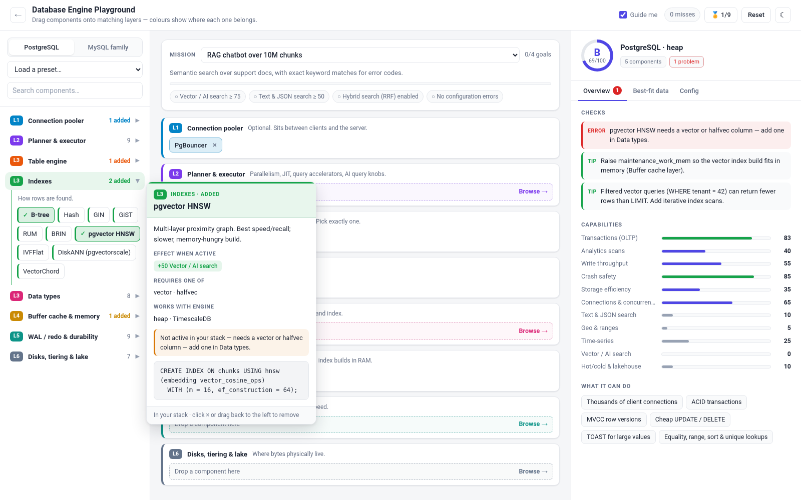
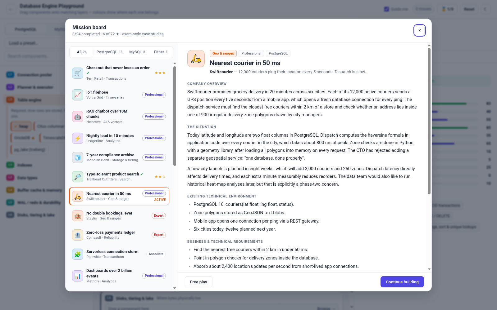
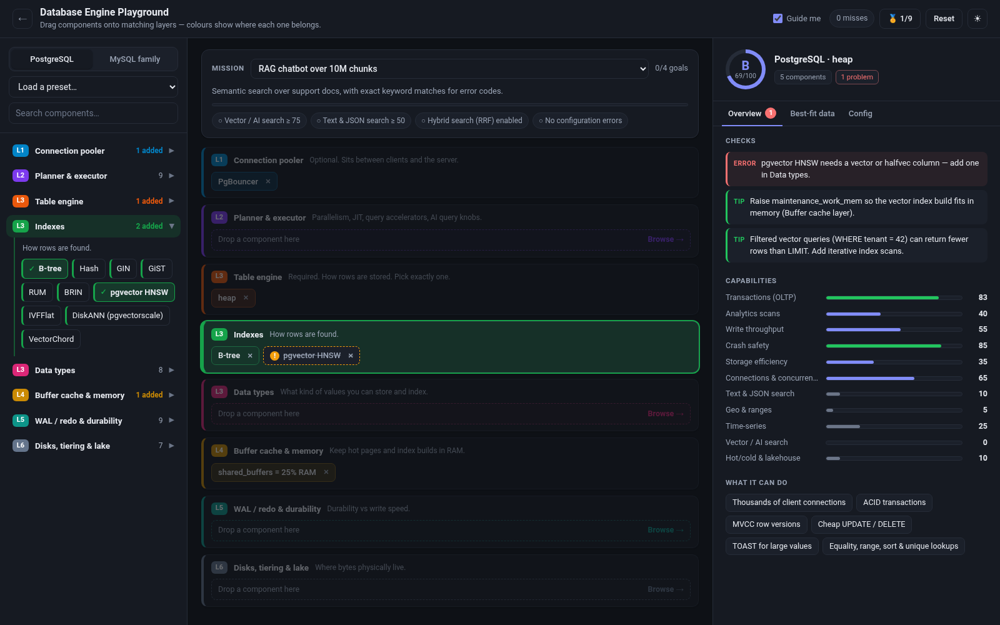
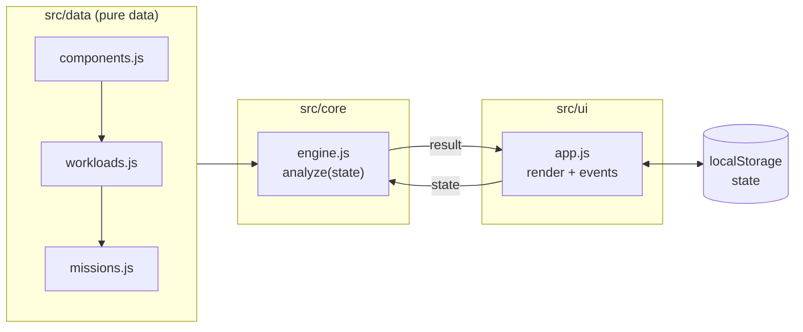

# Database Engine Playground

[](https://github.com/AnikethSD/database-playground/actions/workflows/ci.yml)
[](LICENSE)


**Build a database engine by drag and drop, then see what it's good at.**

Database Engine Playground is a static, gamified learning tool for how **PostgreSQL** and the **MySQL family** (MySQL, Percona Server, MariaDB, HeatWave) are assembled from layers:

- connection poolers
- planner and executor
- table engines, indexes and data types
- buffer cache
- WAL / redo
- storage tiering

Drop components onto colour-coded layers. The playground analyses your configuration immediately and tells you:

- what the build can do
- which workloads it suits, with sample schema and rows
- which settings are dangerous

Then take on **24 exam-style case-study missions**, modelled on Google Cloud Professional Data Engineer / ML Engineer case studies.



> [!NOTE]
> Everything runs locally in the browser: no build step, no dependencies, no network calls.
> Open `index.html` and play.

---

## Table of contents

- [Features](#features)
- [Quick start](#quick-start)
- [How to play](#how-to-play)
- [Missions](#missions)
- [Project structure](#project-structure)
- [Architecture](#architecture)
- [Testing](#testing)
- [Contributing](#contributing)
- [License](#license)

## Features

| | |
| :-- | :-- |
| 🧱 **8 colour-coded layers** | Each layer's colour is shared by its palette group, its stack slot and its hover card. With **Guide me** on, the target layer lights up while you drag. |
| 🧩 **103 components** | 56 PostgreSQL and 47 MySQL-family components, each with effects, prerequisites, engine compatibility, conflicts, distribution availability and config/SQL snippets. |
| 📊 **Live analysis** | 11 capability scores, a grade from S to D, health checks (danger, error, warning, tip), best-fit workloads with sample DDL and rows, and a generated `postgresql.conf` / `my.cnf`. |
| 🎯 **24 case-study missions** | Each has a story, environment, requirements with distractors, an executive quote and a **hidden question**. Goals are hidden too and are checked as you build. |
| ⭐ **Stars and achievements** | 3 stars per mission. Revealing goals or the reference answer costs stars. There are also 9 achievements, such as *Bilingual* and *Living dangerously*. |
| 🌗 **Light and dark themes** | Follows `prefers-color-scheme`, with a toggle in the header. |
| ♿ **Keyboard and screen readers** | Components can be added with Enter or Space. Results panels use ARIA live regions. The mission board is a native `<dialog>`. |

<table>
  <tr>
    <td></td>
    <td></td>
  </tr>
  <tr>
    <td align="center"><sub>Mission board: exam-style case study</sub></td>
    <td align="center"><sub>Guide me: the matching layer glows while dragging</sub></td>
  </tr>
</table>

## Quick start

```bash
git clone https://github.com/AnikethSD/database-playground.git
cd database-playground

# Option 1: just open the file
xdg-open index.html        # macOS: open index.html

# Option 2: serve it (any static server works)
npm start                  # python3 -m http.server 8000, then visit http://localhost:8000
```

The app uses classic `<script>` tags rather than ES modules on purpose, so it works straight from `file://`.

To host it, enable **GitHub Pages** for this repository (Settings → Pages → *Deploy from a branch* → `main` / root). It needs no build step.

## How to play

1. **Pick a family**: PostgreSQL or MySQL family.
2. **Drag components** from the left palette onto the matching coloured layer, or click a component to add it.
   - Dropping onto the wrong layer counts as a *miss*.
   - Hover over any component for a readable card with its effects, prerequisites and a snippet.
3. **Read the analysis** on the right:
   - **Overview:** checks, capability bars and "what it can do".
   - **Best-fit data:** top workloads with sample schema and rows.
   - **Config:** the generated configuration file.
4. **Take a mission**: open **Case study**, read the scenario, reveal the question, and build the stack that answers it.

<details>
<summary><b>Scoring details</b></summary>

- **Capabilities:** the engine's base scores plus the effects of every *active* component and synergy (for example GIN + `pg_trgm`), clamped to 0–100.
- A component is **inactive** (and contributes nothing) if a prerequisite is missing, it does not apply to the chosen engine, or it conflicts with another component.
- **Workload fit** is a weighted sum of capabilities. Workloads that need specialised pieces (such as a vector index for retrieval-augmented generation) are scaled down if those pieces are missing.
- **Score** = best workload fit − 8 × errors − 12 × dangers. **Grade:** S ≥ 90, A ≥ 80, B ≥ 65, C ≥ 50, otherwise D.
- **Mission stars:** 3 by default, 2 if you revealed the goals, 1 if you revealed the reference answer.

</details>

## Missions

Each mission is a ~250–340-word case study. Its sections are:

- company overview
- the situation
- existing technical environment
- business and technical requirements (including red herrings)
- an executive quote
- a hidden question

Several stories include tempting "speed" suggestions, such as `fsync = off`, `synchronous_commit = off` or `full_page_writes = off`. Accepting them fails the hidden goals. After completing a mission, a debrief explains *why* the reference answer works.

| # | Mission | Company | Category | Family | Level |
| --: | :-- | :-- | :-- | :-- | :-- |
| 1 | 🛒 Checkout that never loses an order | Tern Retail | Transactions | PostgreSQL | Associate |
| 2 | 📈 IoT firehose | Voltra Grid | Time-series | PostgreSQL | Professional |
| 3 | 🤖 RAG chatbot over 10M chunks | HelpHive | AI & vectors | PostgreSQL | Professional |
| 4 | ⚡ Nightly load in 10 minutes | Ledgerline | Analytics | PostgreSQL | Professional |
| 5 | 🧊 7-year compliance archive | Meridian Bank | Storage & tiering | Either | Professional |
| 6 | 🔎 Typo-tolerant product search | Trailhead Outfitters | Search | PostgreSQL | Associate |
| 7 | 🛵 Nearest courier in 50 ms | Swiftcourier | Geo & ranges | PostgreSQL | Professional |
| 8 | 🏨 No double bookings, ever | Staylio | Geo & ranges | PostgreSQL | Expert |
| 9 | 🏦 Zero-loss payments ledger | Coinvault | Reliability | MySQL family | Expert |
| 10 | 🧩 Serverless connection storm | Pipewise | Transactions | PostgreSQL | Associate |
| 11 | 📊 Dashboards over 2 billion events | Metricly | Analytics | Either | Professional |
| 12 | 🔥 Analytics without ETL | Fintrail | Analytics | MySQL family | Professional |
| 13 | 🪨 Write-heavy social feed | Chirpline | Storage & tiering | MySQL family | Expert |
| 14 | 🎮 Game session store | Pixelforge | Transactions | PostgreSQL | Professional |
| 15 | ⚖️ Half a billion legal embeddings | Lexora | AI & vectors | PostgreSQL | Expert |
| 16 | 🏥 Clinical RAG on MariaDB | Carewell Health | AI & vectors | MySQL family | Professional |
| 17 | 🪶 Filtered semantic search per tenant | Quillstack | AI & vectors | PostgreSQL | Expert |
| 18 | 🗂️ Rolling 90-day log retention | Streamcast | Storage & tiering | MySQL family | Professional |
| 19 | 🛰️ Query the data lake from Postgres | Orbital Ads | Analytics | PostgreSQL | Professional |
| 20 | 📡 Stream changes to the warehouse | Parcelly | Reliability | Either | Associate |
| 21 | ⚓ Silent corruption on flaky power | Harborline | Reliability | PostgreSQL | Professional |
| 22 | ✈️ Cold cache after failover | Kestrel Air | Transactions | MySQL family | Associate |
| 23 | 🏷️ Filter by JSON tags on MySQL | Bazaar Market | Search | MySQL family | Professional |
| 24 | ☕ Store locator on MySQL | Brewtown Coffee | Geo & ranges | MySQL family | Associate |

Companies and people in the case studies are fictional. See [docs/authoring-missions.md](docs/authoring-missions.md) to write your own.

## Project structure

```text
.
├── index.html                 # App shell: layout, dialogs, script order
├── src/
│   ├── data/                  # Pure data: no DOM, no side effects beyond window.DBP
│   │   ├── components.js      # Layers (SLOTS), capability dimensions (DIMS), 103 components, synergies
│   │   ├── workloads.js       # Workload archetypes + sample data, achievements, presets
│   │   └── missions.js        # 24 case-study missions, categories, levels
│   ├── core/
│   │   └── engine.js          # DBP.analyze(state) and DBP.ddlFor(); pure functions
│   ├── ui/
│   │   └── app.js             # Rendering, drag and drop, hover card, mission board, persistence
│   └── styles/
│       └── app.css            # Design tokens (light/dark), per-layer colour system, components
├── tests/
│   ├── helpers/load-dbp.js    # Loads the browser scripts into Node for testing
│   ├── catalogue.test.js      # Referential integrity of components, workloads, presets
│   ├── engine.test.js         # Behaviour of the analysis engine
│   ├── missions.test.js       # Every mission is well-formed and solvable; traps fail
│   └── ui/                    # Headless-Chrome end-to-end spec + runner
├── docs/
│   ├── architecture.md        # Design, data model, analysis algorithm
│   ├── authoring-missions.md  # How to add a case study
│   └── images/                # Screenshots used in this README
├── .github/workflows/ci.yml   # Syntax check, unit tests, UI tests
├── CONTRIBUTING.md
├── LICENSE                    # Apache 2.0
└── package.json               # Scripts only; zero dependencies
```

## Architecture



- **Unidirectional loop.** Every user action changes `state`, then calls `update()`, which runs `analyze(state)` and re-renders the palette, stack, mission card and analysis panel.
- **Pure analysis.** `engine.js` has no DOM access, so the same function powers the UI and the Node test suite.
- **Secure by construction.** All DOM content is created with `textContent` (no `innerHTML` with data), and there is no network access at all.

Read more in [docs/architecture.md](docs/architecture.md).

## Testing

Requires Node.js ≥ 20. There is nothing to install.

```bash
npm run check     # syntax-check every source file
npm test          # catalogue, engine and mission tests (node:test)
npm run test:ui   # end-to-end UI spec in headless Chrome (set CHROME_BIN if needed)
npm run test:all  # everything
```

The mission tests prove that every reference answer passes its own hidden goals with zero configuration errors. They also check that the traps described in the stories really do fail.

## Contributing

Contributions are welcome, especially new case studies and corrections to component facts. See [CONTRIBUTING.md](CONTRIBUTING.md).

## License

Licensed under the [Apache License, Version 2.0](LICENSE).

*PostgreSQL, MySQL, MariaDB, Percona, HeatWave, TimescaleDB and other names are trademarks of their respective owners. This is an independent educational project, not affiliated with any of them. Capability scores are deliberately simplified teaching heuristics, not benchmarks.*
